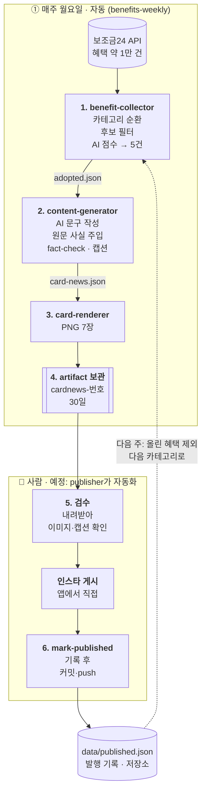
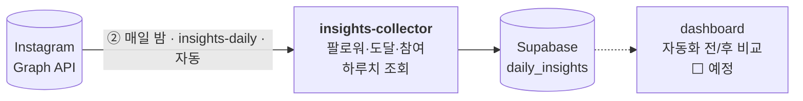

# cardnews — 인스타그램 혜택 카드뉴스 자동화

**매주 한 번, 컴퓨터가 "몰랐던 정부 혜택 5선" 카드뉴스를 자동으로 만든다. 사람은 결과를 확인하고 인스타그램에 올린다.**
그리고 매일 밤 인스타 계정의 성적(팔로워·도달 수)을 자동으로 기록해서, 자동화 도입 전/후 성과를 비교한다.

- 계정: `@hotsoozip` (19~34세 청년 대상, 비공식 큐레이션)
- 데이터: 정부 공공서비스(혜택) 정보 — 보조금24 (공공데이터포털)
- 원칙: **AI는 문구만 쓴다.** 정책명·기관·기한·링크·문의처는 원문에서 코드가 옮기고, AI가 쓴 숫자는 원문과 대조한다.
  틀린 정보를 내보내느니 멈춘다.

전체 로드맵은 [`_docs/insta-cardnews-automation-plan.md`](_docs/insta-cardnews-automation-plan.md),
2026-10-06 맛집 → 혜택 주제 전환 이후 설계는 [`_docs/topic-pivot-benefits-plan.md`](_docs/topic-pivot-benefits-plan.md) 참고.

---

## 한눈에 보기 — 자동으로 도는 일 두 가지

둘 다 내 컴퓨터가 아니라 **GitHub Actions**(GitHub가 빌려주는 클라우드 컴퓨터)에서 정해진 시간에 저절로 돈다.

| | ① 카드뉴스 만들기 | ② 성적 기록하기 |
|---|---|---|
| 워크플로 | [`benefits-weekly`](.github/workflows/benefits-weekly.yml) | [`insights-daily`](.github/workflows/insights-daily.yml) |
| 언제 | 매주 월요일 아침 (예약 KST 07:00) | 매일 밤 (예약 KST 00:30) |
| 하는 일 | 혜택 고르기 → 문구 쓰기 + 사실 확인 → 카드 이미지 7장 | 팔로워·도달 수를 데이터베이스(Supabase)에 저장 |
| 사람 할 일 | 결과 검수 → 인스타 게시 → 발행 기록 | 없음 (두 달마다 토큰 교체만) |

> GitHub는 예약 실행이 붐비면 몇 시간씩 늦게 돌린다. 실제로는 주간 실행이 월요일 오전 10시 전후, 성적 기록은 새벽~아침에 돈다.

---

## 구성 — 앱별 역할

`apps/` 아래 각 앱은 **독립된 프로그램**이다(각자 `package.json`, `.env`, `node_modules`). 한 앱의 출력 파일이 다음 앱의 입력이 된다.

| 위치 | 상태 | 역할 (한 줄) |
|---|---|---|
| [`apps/benefit-collector`](apps/benefit-collector) | ✅ 사용 중 | **혜택 고르기** — 보조금24에서 약 1만 건을 받아 이번 주 카테고리 후보를 거르고, AI 점수로 5건 선정. 발행 기록(`published.json`) 관리 |
| [`apps/content-generator`](apps/content-generator) | ✅ 사용 중 | **문구 쓰기 + 사실 확인** — AI(Claude Haiku, 폴백 Gemini)가 카드 문구를 쓰고, 원문 사실 필드를 합친 뒤 숫자를 원문과 대조. 게시글(캡션)도 생성 |
| [`apps/card-renderer`](apps/card-renderer) | ✅ 사용 중 | **카드 그리기** — 카드뉴스 JSON을 React 화면으로 그리고 Playwright로 찍어 PNG(1080×1350) 7장 생성 |
| [`apps/insights-collector`](apps/insights-collector) | ✅ 사용 중 | **성적 기록** — Meta Graph API로 팔로워·도달 수를 매일 Supabase `daily_insights`에 저장 |
| [`apps/publisher`](apps/publisher) | ⬜ 미구현 | **자동 게시** (예정) — PNG를 인스타그램에 자동 업로드하고 발행 기록까지 |
| `dashboard` | ⬜ 미착수 | **성과 대시보드** (예정) — 자동화 전/후 팔로워·도달 비교 |
| [`apps/research-collector`](apps/research-collector) | 💤 미사용 | 맛집 주제 시절 소재 리서치 (카카오 로컬 + 네이버 트렌드). 2026-10-06 주제 전환으로 쓰지 않음 |
| [`apps/image-matcher`](apps/image-matcher) | 💤 미사용 | 맛집 주제 시절 가게 사진 연결·허락 요청 대상 찾기. 주제 전환으로 쓰지 않음 |
| [`scripts/pipeline.js`](scripts/pipeline.js) | ✅ | 위 세 앱(고르기 → 문구 → 그리기)을 **한 명령으로 이어 실행**. 결과를 한 폴더에 모음 |
| [`shared/schemas`](shared/schemas) | ✅ | 앱 사이에 주고받는 JSON 형식 정의(`benefit.ts`, `card-news.ts`)와 검증 코드 |
| [`.github/workflows`](.github/workflows) | ✅ | 자동 실행 예약 (`benefits-weekly`, `insights-daily`) |
| [`design-reference`](design-reference) | ✅ | 카드 레이아웃 스펙 |

---

## 전체 흐름 다이어그램

### ① 카드뉴스 만들기 (매주)



### ② 성적 기록하기 (매일)



---

## 카드뉴스가 만들어지는 순서

### 1단계. 혜택 모으고 고르기 — 자동 (`benefit-collector`)

1. 보조금24에서 혜택 약 1만 건을 받는다 (24시간 캐시).
2. **이번 주 카테고리**를 정한다. 발행 기록을 보고 가장 오래 안 다룬 카테고리부터 — 생활안정 → 고용·창업 → 주거·자립 → …
3. 공통 조건으로 거른다: 상시 신청, 개인 대상, 19~34세, 전국 또는 서울, 이미 올린 혜택 제외.
4. 남은 후보(예: 41건)를 AI가 "청년에게 쓸모 있는가(relevance)", "잘 모를 법한가(obscurity)"로 1~5점씩 매긴다.
   한 번 매긴 점수는 캐시해서 다음 주에 다시 묻지 않는다.
5. 점수 높은 **5건**을 고른다 → `adopted.json`

### 2단계. 카드 문구 쓰기 + 사실 확인 — 자동 (`content-generator`)

1. AI가 회차 제목, 카드별 소제목·혜택 요약·세부 항목 같은 **문구만** 쓴다.
2. 정책명·기관·신청 기한·링크·신청 방법·문의처는 **원문에서 코드가 그대로 옮긴다.**
3. **fact-check**: AI가 쓴 문구 속 숫자가 원문에 있는지 하나하나 대조한다. 틀리면 문제 목록을 주고 1회 재생성,
   그래도 틀리면 **멈춘다.**
4. 인스타 게시글(`caption.txt`)을 만든다 — 혜택별 원문 링크·문의처, 확인 안내, 해시태그 (AI를 거치지 않음).

### 3단계. 카드 이미지 만들기 — 자동 (`card-renderer`)

- 인스타 규격(1080×1350) PNG **7장**: 표지 1장 + 혜택 5장 + 마무리(팔로우 유도) 1장.
- 글자가 칸에 안 들어가면 잘라 내보내지 않고 **렌더를 실패**시킨다.

### 4단계. 결과물 보관 — 자동

- 이미지 7장 + 캡션 + `adopted.json`을 그 실행의 **artifact `cardnews-<번호>`**로 올린다 (30일 보관).
- 저장소(코드)에는 커밋하지 않는다 → 이유는 아래 [결과물 보관 방식](#결과물-보관-방식--왜-저장소에-안-올리나).

### 5단계. 검수하고 인스타에 올리기 — 🙋 사람

1. **내려받기** — GitHub → Actions 탭 → 해당 실행 → 맨 아래 `cardnews-<번호>` 클릭. 또는:
   ```bash
   gh run list --workflow benefits-weekly.yml --limit 3          # 실행 ID 확인
   gh run download <실행ID> -n cardnews-<번호> -D apps/card-renderer/output/cardnews-<번호>
   ```
2. **검수** — 이미지와 `caption.txt`를 읽는다. fact-check는 숫자만 보므로 "무료", "누구나", "오프라인" 같은
   숫자 없는 표현은 사람이 원문과 대조한다.
3. **게시** — 인스타그램 앱에서 이미지 7장을 슬라이드로 올리고 `caption.txt` 내용을 붙여 넣는다.

### 6단계. "올렸다"고 기록하기 — 🙋 사람

```bash
cd apps/benefit-collector
npm run mark-published -- --input ../card-renderer/output/cardnews-<번호>/adopted.json
git add data/published.json
git commit -m "chore: <카테고리> 회차 발행 기록"
git push
```

- 이 기록이 있어야 **다음 주에 같은 혜택이 다시 안 나오고, 카테고리가 다음으로 넘어간다.**
- 기록을 빼먹으면 매주 같은 후보가 나온다. 검수에서 탈락시켜 안 올린 회차는 기록하지 않는다.

---

## 성적 기록 — 완전 자동 (`insights-collector`)

- 매일 "어제" 하루치 팔로워 수·도달(reach)·참여 계정·상호작용·게시물 수를 Supabase `daily_insights`에 저장한다.
- 자동화 전/후 비교의 근거 데이터다. **베이스라인은 2026-11-13부터** 쌓이고 있다 (그 전 7주는 Meta 쪽 차단으로 실패).
- 🙋 **두 달에 한 번**: Meta 장기 토큰 교체 (다음 만료 2027-01-13). 절차는 [`apps/insights-collector`](apps/insights-collector) 참고.

---

## 처음 한 번 설정

### 내 컴퓨터에서 돌릴 때

```bash
# 쓰는 앱마다 한 번씩
cd apps/benefit-collector   && npm install
cd ../content-generator     && npm install
cd ../card-renderer         && npm install && npx playwright install chromium
cd ../insights-collector    && npm install   # 성적 기록을 로컬에서 돌릴 때만
```

앱마다 `.env.example`을 복사해 `.env`를 만들고 값을 채운다.

| 앱 | 필요한 값 |
|---|---|
| benefit-collector | `DATA_GO_KR_SERVICE_KEY`, `ANTHROPIC_API_KEY`, (폴백) `GEMINI_API_KEY`, (선택) `LLM_PRIMARY` |
| content-generator | `ANTHROPIC_API_KEY`, (폴백) `GEMINI_API_KEY`, (선택) `LLM_PRIMARY` |
| card-renderer | 없음 |
| insights-collector | `META_ACCESS_TOKEN`, `IG_BUSINESS_ACCOUNT_ID`, `SUPABASE_URL`, `SUPABASE_SERVICE_ROLE_KEY`, (토큰 교환용) `META_APP_ID`, `META_APP_SECRET` |

### GitHub Actions (자동 실행)

저장소 **Settings → Secrets and variables → Actions**에 등록한다.

- `benefits-weekly`: `DATA_GO_KR_SERVICE_KEY`, `ANTHROPIC_API_KEY`, `GEMINI_API_KEY`(폴백)
- `insights-daily`: `META_ACCESS_TOKEN`, `IG_BUSINESS_ACCOUNT_ID`, `SUPABASE_URL`, `SUPABASE_SERVICE_ROLE_KEY`

---

## 월요일을 기다리지 않고 직접 돌리기

**GitHub에서** — Actions 탭 → `benefits-weekly` → **Run workflow** (시리즈·카테고리·자치구·개수 입력 가능). 또는:

```bash
gh workflow run benefits-weekly.yml
```

**내 컴퓨터에서** (저장소 루트) — 1~3단계를 한 번에:

```bash
npm run pipeline -- --handle hotsoozip --collect                       # 순환 순서대로 5건
npm run pipeline -- --handle hotsoozip --collect --category 주거·자립   # 카테고리 지정
npm run pipeline -- --handle hotsoozip --collect --series district --region 동작구  # 자치구 시리즈
npm run pipeline -- --handle hotsoozip                                 # 수집 없이 가장 최근 adopted.json으로
```

결과는 `apps/card-renderer/output/benefit/<이름>/` 한 폴더에 모인다 (`--name`으로 이름 지정, 기본은 KST 타임스탬프):

| 파일 | 용도 |
|---|---|
| `01-cover.png` … `07-cta.png` | 카드 이미지 (게시용) |
| `caption.txt` | 게시글 본문 (붙여 넣기용) |
| `adopted.json` | 선정된 5건 + 원문 — 게시 후 `mark-published --input`에 넘김 |
| `scores.json` | 후보 전체의 AI 점수와 이유 (검수 참고) |
| `card-news.json`, `card-news.meta.json` | 카드 내용 JSON, 어느 AI가 만들었는지·fact-check 결과 |

한 단계라도 실패하면 거기서 멈춘다. 각 앱을 자기 폴더에서 실행하므로 앱별 `.env`/`npm install`이 필요하다.

---

## 결과물 보관 방식 — 왜 저장소에 안 올리나

자동 실행의 결과물은 **실행 기록에 붙는 첨부 파일(artifact)**로만 남고, 저장소에는 커밋되지 않는다. 일부러 그렇게 했다.

1. **워크플로 권한이 읽기 전용이다** (`permissions: contents: read`). 봇이 레포에 커밋할 수 없어서, 레포에는 사람이
   검수한 변경만 들어간다.
2. **"만들었다"와 "올렸다"를 구분한다** (2026-10-21 결정). 레포에 커밋하는 의미 있는 파일은 발행 기록뿐인데, 만들자마자
   기록하면 검수에서 탈락하거나 게시를 건너뛴 회차의 혜택이 "올렸음"으로 처리돼 후보에서 영영 빠진다.
   그래서 실제로 게시한 사람이 `mark-published`로 기록한다. publisher가 생기면 게시 성공 직후 자동 기록으로 바뀐다.

**약점**: artifact는 30일 뒤 삭제되고, 로컬 출력 폴더(`apps/*/output/`)는 `.gitignore` 대상이다. 게시한 PNG 원본은
내 컴퓨터와 인스타그램에만 남는다 (`card-news.json`이 있으면 같은 이미지를 다시 그릴 수는 있다).

---

## 자동화 현황

| 단계 | 상태 |
|---|---|
| 혜택 수집·선별 | ✅ 자동 |
| 문구 작성 + 사실 확인 | ✅ 자동 |
| 카드 이미지 생성 | ✅ 자동 |
| 매일 성적 기록 | ✅ 자동 |
| 결과 검수 | 🙋 사람 (자동 게시 후에도 사람 승인 단계로 남길 예정) |
| 인스타 게시 | 🙋 사람 → `publisher`로 자동화 예정 |
| 발행 기록 | 🙋 사람 → 게시와 함께 자동화 예정 |
| 실패 알림 | ❌ 없음 |
| 성과 대시보드 | ❌ 미착수 |
| Meta 토큰 교체 | 🙋 두 달마다 사람 → 자동화 예정 |

**완성되면**: 월요일에 카드가 만들어지면 사람은 확인하고 **승인만** 누른다 → 인스타 게시·발행 기록이 자동으로 되고,
대시보드에서 자동화 전/후 성과를 본다.

---

## 문서

- [`_docs/insta-cardnews-automation-plan.md`](_docs/insta-cardnews-automation-plan.md) — 전체 로드맵, Phase별 설계
- [`_docs/topic-pivot-benefits-plan.md`](_docs/topic-pivot-benefits-plan.md) — 혜택 주제 전환 설계 (선별 규칙, fact-check, 발행 기록)
- [`_docs/2026-11-14-plan.md`](_docs/2026-11-14-plan.md) — 완성까지 남은 작업
- [`_docs/llm-provider-fallback-plan.md`](_docs/llm-provider-fallback-plan.md) — AI 2-프로바이더 폴백 설계 (§7: 2026-11-22 기본을 Haiku로 교체)
- [`_docs/dev-log/`](_docs/dev-log) — 작업 일지
- [`design-reference/spec.md`](design-reference/spec.md) — 카드 레이아웃 스펙
